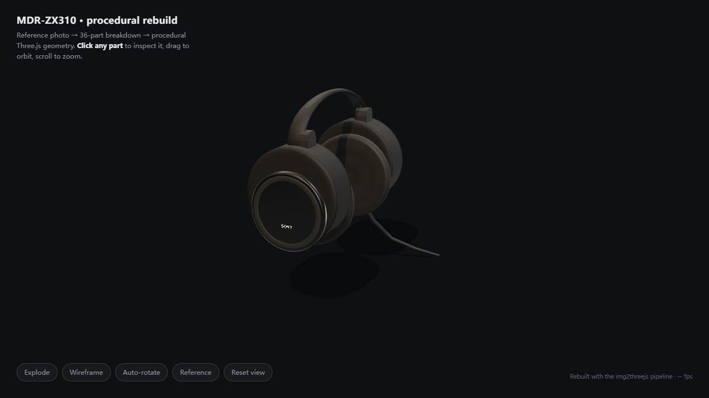
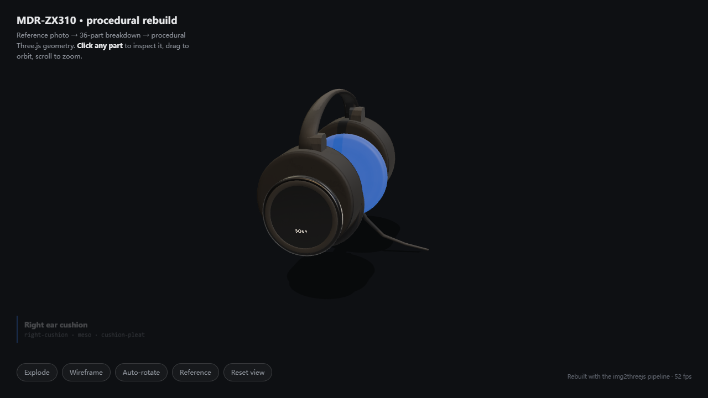
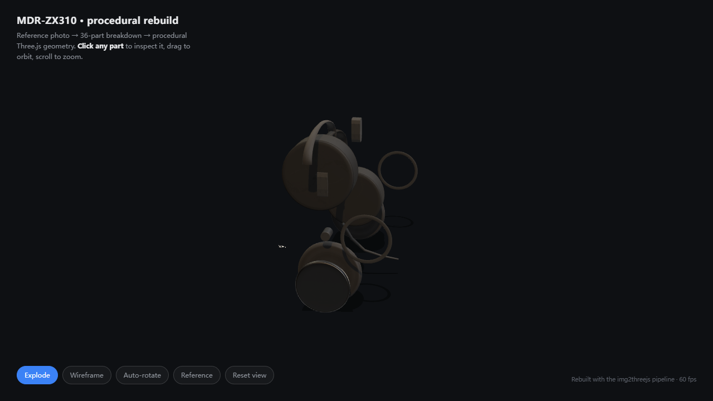
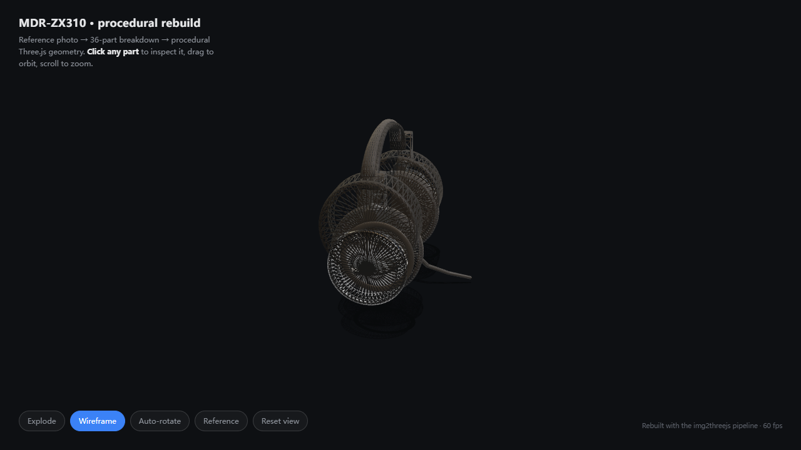

# photo-to-3d-demo

An agent skill that turns product photographs into a **tested, single-file interactive Three.js demo**:
orbit, click a part to inspect it, explode the assembly, wireframe, auto-rotate, reset — all in one HTML
file you can mail to someone.



It is a front end for [img2threejs](https://github.com/img2threejs/img2threejs). Upstream reconstructs a
model from a photo by generating Three.js factory code, pass by pass, and stops there. This repository
adds the delivery half:

| Upstream gives you | This repo adds |
| --- | --- |
| a generated `factory.ts` | a viewer shell: picking, selection, explode, wireframe, HUD, reference card |
| review scripts and a spec schema | the evidence capture contract (`setCamera` + seven render modes) |
| a component tree | a single-file packer that inlines JS and every texture (3-6 MB, zero external refs) |
| — | six interaction assertions that run in a real browser and produce screenshots |
| — | a driver layer so the same test runs headless or inside an app session |

Nothing from img2threejs is copied here; the scripts call its CLI. See [NOTICE](NOTICE).

## What you get

```
dist/<product>.html        4.0 MB, opens offline, no CDN, no sibling files
review/captures/*.png      one evidence frame per pass, plus the interaction screenshots
spec/object-sculpt-spec.json  the whole model as data: geometry, materials, assumptions, review history
```

The demo page itself:



Clicking a part lights exactly that part — not its mirrored twin — and prints its component id, level
and material into the readout. That single behaviour is where most first attempts fail, because the
generator emits one material instance per material id and both sides share it.



## Requirements

- Node 18+ and Chrome (for `playwright-core`; `npx playwright install chromium` also works)
- Python 3.9+ (standard library only — no Pillow, no NumPy)
- bash with `find`/`sort`/`uniq`
- A checkout of [img2threejs](https://github.com/img2threejs/img2threejs)
- Two to four photographs of one object

## Quick start

```bash
git clone <this repo> ~/photo-to-3d-demo
ENGINE=~/img2threejs                       # a checkout of upstream
SLUG=my-product
WP=~/photo-to-3d/$SLUG

bash assets/build/setup_workspace.sh "$WP"
cp /path/to/photo.jpg "$WP/reference/ref.jpg"

# stage 1-2: crop per material, extract PBR, write spec/object-sculpt-spec.json
# then, per pass (fixed order, one concern per pass):
bash assets/build/build_pass.sh "$WP" blockout "$ENGINE"
python -m http.server 8100 --directory "$WP/build" &

node assets/build/capture_frames.mjs --url http://127.0.0.1:8100/ \
  --out "$WP/review/captures" --pass-id blockout --shots silhouette,refmatch --driver playwright

# look at the frame, edit the spec, record the review, next pass
python "$ENGINE/forge/stage4_review/append_review.py" "$WP/spec/object-sculpt-spec.json" ...
```

Then pack and test:

```bash
python assets/build/pack_single.py "$WP/build" "$WP/dist/$SLUG.html"
node assets/build/test_interactions.mjs --url http://127.0.0.1:8100/dist/$SLUG.html \
  --out "$WP/review/captures" --prefix single-file --driver playwright
```

The test exits non-zero if any assertion fails and writes its screenshots next to the report. What to
change in each pass, and how to judge it, is in [`SKILL.md`](SKILL.md) and
[`references/pipeline.md`](references/pipeline.md).

## The eight passes

```
blockout -> structural-pass -> form-refinement -> material-pass
         -> surface-pass -> lighting-pass -> interaction-pass -> optimization-pass
```

The order is fixed because skipping a pass destroys attribution: you can no longer tell whether a
difference is geometry, material or lighting. Each pass: generate, build, capture evidence, **look at
it**, edit the spec, record the review. Batch-changing parameters without looking produces differences
nobody can explain.

No pass is scored by the script. `append_review.py` records what you say you saw, and refuses to record
it without layer scores, a viewpoint list (which must include `long-axis` and `thickness-axis`) and
screenshot files that exist on disk. Low scores are allowed; missing scores are not.

## Layout

```
SKILL.md                    the procedure an agent follows, and when to refuse the job
plugin.json                 manifest for the plugin harness (schema 1)
references/
  pipeline.md               what to change and what to look for in each pass
  traps.md                  26 symptom -> cause -> fix entries from real deliveries
  review-cli.md             the append_review.py flag set, and the rules it enforces
  browser-run.md            both drivers, capture presets, emitImage
assets/build/
  setup_workspace.sh        workspace tree + pinned three@0.169.0, esbuild@0.24.0
  build_pass.sh             generate factory -> copy maps -> bundle
  pack_single.py            inline JS + every texture, verify zero external refs
  browser.mjs               backend-agnostic page helpers
  capture_frames.mjs        seven capture presets
  test_interactions.mjs     six assertions + screenshots
assets/viewer/
  index.template.html       the page (localised en/zh)
  main.template.ts          picking, selection, explode, wireframe, HUD, capture hook
  render_viewer.py          fills the templates from the generated factory exports
drivers/
  playwright.mjs            launches Chrome itself; works anywhere
  zcode.mjs                 uses the host app's browser bridge
  index.mjs                 dispatcher (--driver, DEMO_DRIVER)
```

`build/` and `dist/` never enter the repository; `setup_workspace.sh` puts them outside it.

## The browser test

Six assertions, all measured, not assumed:

1. the camera moved after a drag
2. after a click, the readout is populated and **only the clicked mesh** is lit
3. a click that hits no part clears the highlight
4. explode moved parts by more than zero, and the camera refit to keep them in frame
5. wireframe covers 100% of meshes
6. auto-rotate advances the azimuth when on, and holds still when off



They run under either driver: `--driver playwright` launches its own Chrome (no app session needed),
`--driver zcode` uses the host application's browser bridge. Both speak the same tab interface, so the
assertions are identical. `references/browser-run.md` covers the bootstrap and the three gotchas
(compositor screenshot timeouts, OrbitControls damping, opening a tab in a cold session).

## When not to use this

- Organic forms — faces, cloth folds, hair, plants. Use scanning or conventional modelling.
- Anything that has to be machined, maintained or dimensionally accurate. This is a visual
  reconstruction, not a CAD model.
- Glass- or mirror-heavy objects; the photo-derived maps degrade badly there.
- When the user just wants a picture of a 3D thing — a short video is faster.

## License

Apache-2.0. See [LICENSE](LICENSE) and [NOTICE](NOTICE). Not affiliated with img2threejs, the brands of
any product used as a test subject, or Three.js.