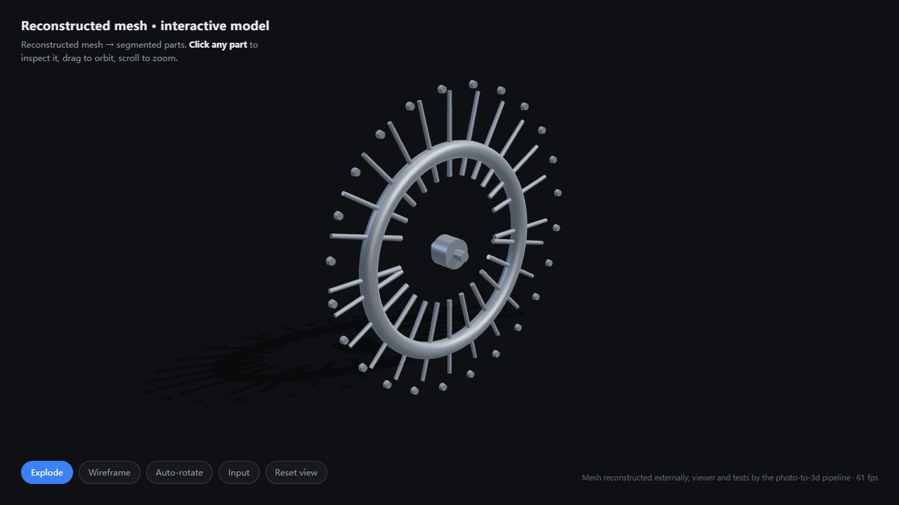

# photo-to-3d-demo

An agent skill that turns product photographs into a **tested, single-file interactive Three.js demo**:
orbit, click a part to inspect it, explode the assembly, wireframe, auto-rotate, reset — all in one HTML
file you can mail to someone.

A packed example ships in [`demo/`](demo/README.md): open `demo/mdr-zx310.html` by double-clicking, with
nothing installed and nothing built. [`demo/spoked-wheel-mesh.html`](demo/README.md) is the second route:
a reconstructed mesh turned into 51 clickable parts — 24 spokes and 24 rivets included.


It is a front end for [img2threejs](https://github.com/img2threejs/img2threejs). Upstream walks a
photo-derived spec through eight review passes, generates Three.js factory code from it, and stops
there. This repository adds the delivery half — and the same delivery half works on a mesh you already
have, with no upstream checkout at all:

| Upstream gives you | This repo adds |
| --- | --- |
| a generated `factory.ts` | a viewer shell: picking, selection, explode, wireframe, HUD, reference card |
| review scripts and a spec schema | the evidence capture contract (`setCamera` + seven render modes) |
| a component tree | a single-file packer that inlines JS and every texture (3-6 MB, zero external refs) |
| — | six interaction assertions that run in a real browser and produce screenshots |
| — | a driver layer so the same test runs headless or inside an app session |

Nothing from img2threejs is copied here; the scripts call its CLI. See [NOTICE](NOTICE).

## What this is (and is not)

The generator **never opens the photo**. `generate_threejs_factory.py` reads
`spec/object-sculpt-spec.json` and compiles it into Three.js primitives — box, cylinder, cone, lathe,
extrude. The numbers in that spec were written by an agent (or a person) after looking at the
photograph. That is the whole trick, and it is worth saying plainly:

| Layer | Source | Reads pixels? |
| --- | --- | --- |
| geometry | numbers in the spec, assembled from primitives | **no** |
| materials | crops → palette + albedo / roughness / height / normal / ao | **yes** — the stage1 extractors read pixels; the demo's 35 maps came from exactly this |
| proportions | a person or model comparing a render against the photo | no solver, no measurement |

So the fidelity ceiling is the resolution of **primitives**, not the resolution of the photo. Spokes,
linkages, rivets, knit, engraved lettering do not come out of a photograph here — you would have to build
them from primitives too, and that is where attempts collapse into a pile of loose parts.

The name describes the **input and the output**, not the method: a photo goes in, an interactive 3D page
comes out, and a measured primitive assembly sits in between. Every delivery states which parts were
measured and which were inferred.

### Two routes

That ceiling belongs to the spec compiler, not to this pipeline. When a mesh exists, the same viewer, part
tree, capture contract and six assertions apply — and then the geometry is whatever the reconstruction
produced, spokes and rivets included.

| You have | Route | Command |
| --- | --- | --- |
| photographs only | **A** — procedural spec, eight review passes | `build_pass.sh` |
| a GLB/GLTF from Hunyuan3D, Tripo, Meshy, a scanner or a DCC tool | **B** — mesh import | `build_mesh.sh` |

Route B does not reconstruct anything: no neural model ships here, nothing is uploaded, there is no GPU
step. You bring the mesh; this pipeline makes it addressable, testable and single-file. The hard part is
that a reconstructed GLB is usually one primitive with no named parts, so it is welded and segmented —
connected components first, creases inside large shells, spatial chunks only when the mesh is noise:

| Mesh | Segmentation | Parts |
| --- | --- | --- |
| merged CAD-style export (disjoint pieces) | components | one part per piece |
| one extruded shell (gear, bracket) | components + creases | teeth / walls / caps |
| neural reconstruction (one noisy surface) | spatial fallback | chunks, labelled as chunks |

`window.__demo.model.userData.meshStats` reports which strategy actually ran.



The shipped wheel demo, exploded: 51 parts, every one of them an island in the file.

## What you get

```
dist/<product>.html        4.0 MB, opens offline, no CDN, no sibling files
review/captures/*.png      one evidence frame per pass, plus the interaction screenshots
spec/object-sculpt-spec.json  the whole model as data: geometry, materials, assumptions, review history
```

The demo page itself:


Clicking a part lights exactly that part — not its mirrored twin — and prints its component id, level
and material into the readout. That single behaviour is where most first attempts fail, because the
generator emits one material instance per material id and both sides share it.


## Install (once per machine)

```bash
git clone <this repo> ~/photo-to-3d-demo
bash ~/photo-to-3d-demo/assets/build/bootstrap.sh --check
```

`bootstrap.sh` installs `playwright-core` into the repo — it drives the Chrome already on the machine and
downloads no browser — and clones [img2threejs](https://github.com/img2threejs/img2threejs) into
`$HOME/.cache/photo-to-3d/img2threejs` when no checkout exists. `--check` then runs the generator's
`--help` and launches one real browser through the driver layer, so a fresh machine fails here instead of
three passes in.

It checks for Node 18+, npm, git, Python 3.9+ (standard library only) and Chrome, and reports what is
missing. `three` and `esbuild` are deliberately **not** installed globally: `setup_workspace.sh` pins them
per workspace, because a newer three can shift PMREM or OrbitControls behaviour and invalidate a review
that was already signed off.

Two optional variables, both with working defaults:

| Variable | Default | Set it when |
| --- | --- | --- |
| `IMG2THREEJS_ENGINE` | third argument to `build_pass.sh`, else `~/.workbuddy/skills/img2threejs`, else `~/.cache/photo-to-3d/img2threejs` | the upstream checkout lives elsewhere |
| `PYTHON` | `python3`, falling back to `python` | neither is on `PATH`, or `python3` is older than 3.9 |

## Quick start

You need two to four photographs of one object; the packed demo in `demo/` needs none of this.

```bash
bash ~/photo-to-3d-demo/assets/build/bootstrap.sh --check   # deps + engine, once

SLUG=my-product
WP=~/photo-to-3d/$SLUG
bash ~/photo-to-3d-demo/assets/build/setup_workspace.sh "$WP"
cp /path/to/photo.jpg "$WP/reference/ref.jpg"

# stage 1-2: crop per material, extract PBR, write spec/object-sculpt-spec.json
# then, per pass (fixed order, one concern per pass):
bash ~/photo-to-3d-demo/assets/build/build_pass.sh "$WP" blockout
python3 -m http.server 8100 --directory "$WP/build" &

node ~/photo-to-3d-demo/assets/build/capture_frames.mjs --url http://127.0.0.1:8100/ \
  --out "$WP/review/captures" --pass-id blockout --shots silhouette,refmatch --driver playwright

# look at the frame, edit the spec, record the review, next pass
ENGINE="${IMG2THREEJS_ENGINE:-$HOME/.cache/photo-to-3d/img2threejs}"
python3 "$ENGINE/forge/stage4_review/append_review.py" "$WP/spec/object-sculpt-spec.json" ...
```

Then pack and test:

```bash
python3 ~/photo-to-3d-demo/assets/build/pack_single.py "$WP/build" "$WP/dist/$SLUG.html"
node ~/photo-to-3d-demo/assets/build/test_interactions.mjs --url http://127.0.0.1:8100/dist/$SLUG.html \
  --out "$WP/review/captures" --prefix single-file --driver playwright
```

The test exits non-zero if any assertion fails and writes its screenshots next to the report. What to
change in each pass, and how to judge it, is in [`SKILL.md`](SKILL.md) and
[`references/pipeline.md`](references/pipeline.md).

## Quick start — route B: a mesh you already have

No spec, no eight passes, and no img2threejs checkout: this path needs Node, `three`, `esbuild` and Python.

```bash
WP=~/photo-to-3d/my-widget
bash ~/photo-to-3d-demo/assets/build/build_mesh.sh "$WP" /path/to/model.glb --locale en \
  --ref-photo /path/to/photo.jpg          # optional: paints the "Input" card

python3 ~/photo-to-3d-demo/assets/build/pack_single.py "$WP/build" "$WP/dist/widget.html" --mesh
node ~/photo-to-3d-demo/assets/build/test_interactions.mjs --url http://127.0.0.1:8100/dist/widget.html \
  --out "$WP/review/captures" --prefix mesh --driver playwright
```

The build welds duplicate vertices (a merged GLB is a non-indexed soup, so index-based connectivity would
report one part per triangle), bakes node transforms, splits the surface into parts, normalises the mesh
to unit size, and embeds the GLB as a base64 data URL so the packed page keeps `external_refs: []`.

When the part tree is wrong, the flags are the only knobs — the mesh itself is not yours to edit:

| Symptom | Flag |
| --- | --- |
| one part, nothing to explode | lower `--mesh-dihedral`, or `--mesh-partition spatial` |
| caps and shells split off solid parts | raise `--mesh-min-segment-triangles` |
| thousands of shards | lower `--mesh-max-parts` |
| separate pieces came out merged | `--mesh-partition components` |
| blown out | `--exposure` (mesh default 0.72) |

Two fixtures ship in [`demo/fixtures/`](demo/README.md) and can be regenerated with
`assets/build/make_sample_mesh.mjs`, so the mesh path is testable without a modelling tool or a network.

## The eight passes

```
blockout -> structural-pass -> form-refinement -> material-pass
         -> surface-pass -> lighting-pass -> interaction-pass -> optimization-pass
```

The order is fixed because skipping a pass destroys attribution: you can no longer tell whether a
difference is geometry, material or lighting. Each pass: generate, build, capture evidence, **look at
it**, edit the spec, record the review. Batch-changing parameters without looking produces differences
nobody can explain.

No pass is scored by the script. `append_review.py` records what you say you saw, and refuses to record
it without layer scores, a viewpoint list (which must include `long-axis` and `thickness-axis`) and
screenshot files that exist on disk. Low scores are allowed; missing scores are not.

## Layout

```
SKILL.md                    the procedure an agent follows, and when to refuse the job
plugin.json                 manifest for the plugin harness (schema 1)
demo/                       one packed deliverable, to open without building anything
docs/screenshots/           the five frames the README shows, taken by the browser test
references/
  pipeline.md               what to change and what to look for in each pass
  traps.md                  31 symptom -> cause -> fix entries from real deliveries
  review-cli.md             the append_review.py flag set, and the rules it enforces
  browser-run.md            both drivers, capture presets, emitImage
assets/build/
  bootstrap.sh              dependency check + engine clone + one browser launch (--check)
  setup_workspace.sh        workspace tree + pinned three@0.169.0, esbuild@0.24.0
  build_pass.sh             route A: generate factory -> copy maps -> bundle
  build_mesh.sh             route B: embed GLB -> mesh_rig + viewer -> bundle
  make_sample_mesh.mjs      regenerate demo/fixtures/*.glb with no modelling tool
  pack_single.py            inline JS + every texture, verify zero external refs
  browser.mjs               backend-agnostic page helpers
  capture_frames.mjs        seven capture presets
  test_interactions.mjs     six assertions + screenshots
assets/viewer/
  index.template.html       the page (localised en/zh)
  main.template.ts          picking, selection, explode, wireframe, HUD, capture hook
  render_viewer.py          fills the templates from either a factory or a GLB
  mesh_rig.ts               route B: loader, welding, segmentation, default rig
drivers/
  playwright.mjs            launches Chrome itself; works anywhere
  zcode.mjs                 uses the host app's browser bridge
  index.mjs                 dispatcher (--driver, DEMO_DRIVER)
demo/
  fixtures/spoked-wheel.glb, gear.glb   mesh-path fixtures, regenerable from source
```

`build/` and `dist/` never enter the repository; `setup_workspace.sh` puts them outside it.

## The browser test

Six assertions, all measured, not assumed:

1. the camera moved after a drag
2. after a click, the readout is populated and **only the clicked mesh** is lit
3. a click that hits no part clears the highlight
4. explode moved parts by more than zero, and the camera refit to keep them in frame
5. wireframe covers 100% of meshes
6. auto-rotate advances the azimuth when on, and holds still when off


They run under either driver: `--driver playwright` launches its own Chrome (no app session needed),
`--driver zcode` uses the host application's browser bridge. Both speak the same tab interface, so the
assertions are identical. `references/browser-run.md` covers the bootstrap and the three gotchas
(compositor screenshot timeouts, OrbitControls damping, opening a tab in a cold session).

## When not to use this

- Organic forms — faces, cloth folds, hair, plants. Use scanning or conventional modelling.
- Anything that has to be machined, maintained or dimensionally accurate. This is a visual
  reconstruction, not a CAD model.
- Glass- or mirror-heavy objects; the photo-derived maps degrade badly there.
- When the user just wants a picture of a 3D thing — a short video is faster.
- When the user needs a **reconstructed mesh** and has none — that is a neural image-to-3D service, not a
  spec compiler. Once the mesh exists, route B delivers it.

## License

Apache-2.0. See [LICENSE](LICENSE) and [NOTICE](NOTICE). Not affiliated with img2threejs, the brands of
any product used as a test subject, or Three.js.