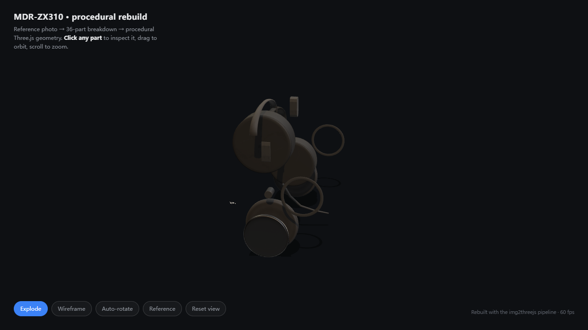

# photo-to-3d-demo

把一个产品照片集，做成**经过实测的单文件交互式 Three.js 演示页**：可拖拽旋转、点选零件、爆炸拆解、线框、自动旋转、重置视角——全部在一个 HTML 文件里，发给人就能打开。

现成的成品在 [`demo/`](demo/README.md)：双击 `demo/mdr-zx310.html` 就能看，不用装任何东西，也不用构建。


它是 [img2threejs](https://github.com/img2threejs/img2threejs) 的前端封装。上游做的事是：按轮次
（pass）从照片重建模型、生成 Three.js 工厂代码，到生成完就结束了。这个仓库补的是**交付的另一半**：

| 上游给的 | 这里补的 |
| --- | --- |
| 生成好的 `factory.ts` | 预览壳：拾取、选中高亮、爆炸、线框、HUD、参考图卡片 |
| 评审脚本与 spec 规范 | 证据抓帧契约（`setCamera` + 七种渲染模式） |
| 组件树 | 单文件打包器，内联 JS 与全部贴图（3–6 MB，零外部引用） |
| — | 五项交互断言，在真实浏览器里跑并产出截图 |
| — | 驱动层抽象，同一套测试既能无头跑，也能在宿主 app 里跑 |

本仓库没有复制 img2threejs 的任何代码，只是调用它的命令行工具，见 [NOTICE](NOTICE)。

## 交付物长什么样

```
dist/<产品名>.html            约 4 MB，离线可开，无 CDN、无同级文件
review/captures/*.png         每轮至少一张证据帧，加交互测试截图
spec/object-sculpt-spec.json  整个模型即数据：几何、材质、假设、评审历史
```


点一个零件，只有它亮——镜像的另一半不会跟着亮，读数区打印它的组件 id、层级、材质。第一次做基本
都会在这里翻车：生成器**每个材质 id 只发一个材质实例**，左右件共用。



## 安装（每台机器一次）

```bash
git clone <本仓库> ~/photo-to-3d-demo
bash ~/photo-to-3d-demo/assets/build/bootstrap.sh --check
```

`bootstrap.sh` 会做两件事：把 `playwright-core` 装进仓库（它驱动你本机已有的 Chrome，不下载浏览器）；
在没有现成 checkout 时，把 [img2threejs](https://github.com/img2threejs/img2threejs) clone 到
`$HOME/.cache/photo-to-3d/img2threejs`。之后 `--check` 会跑一遍生成器的 `--help`，并通过驱动层真正
拉起一次浏览器——所以缺东西的机器在这里就失败，而不是做到第三轮才发现。

它检查 Node 18+、npm、git、Python 3.9+（只用标准库）和 Chrome，缺什么就直说。`three` 与 `esbuild`
**故意不**全局安装：由 `setup_workspace.sh` 按工作区固定版本，因为换一个 three 可能改变 PMREM 或
OrbitControls 的行为，把已经签过字的评审结果作废。

两个变量都可选，默认值能跑：

| 变量 | 默认解析顺序 | 什么时候要设 |
| --- | --- | --- |
| `IMG2THREEJS_ENGINE` | `build_pass.sh` 第三个参数 → `~/.workbuddy/skills/img2threejs` → `~/.cache/photo-to-3d/img2threejs` | 上游 checkout 放在别处 |
| `PYTHON` | `python3`，没有再找 `python` | 两个都不在 `PATH`，或 `python3` 低于 3.9 |

## 快速开始

还需要同一个物体的 2–4 张照片；只看 `demo/` 里的成品则什么都不用装。

```bash
bash ~/photo-to-3d-demo/assets/build/bootstrap.sh --check   # 依赖 + 引擎，一次即可
SLUG=my-product
WP=~/photo-to-3d/$SLUG

bash ~/photo-to-3d-demo/assets/build/setup_workspace.sh "$WP"
cp /path/to/photo.jpg "$WP/reference/ref.jpg"

# 阶段 1–2：按材质裁图、提取 PBR、写 spec/object-sculpt-spec.json
# 然后逐轮执行（顺序固定，一轮只解决一件事）：
bash ~/photo-to-3d-demo/assets/build/build_pass.sh "$WP" blockout
python3 -m http.server 8100 --directory "$WP/build" &

node ~/photo-to-3d-demo/assets/build/capture_frames.mjs --url http://127.0.0.1:8100/ \
  --out "$WP/review/captures" --pass-id blockout --shots silhouette,refmatch --driver playwright

# 看这张帧 → 改 spec → 记录评审 → 下一轮
ENGINE="${IMG2THREEJS_ENGINE:-$HOME/.cache/photo-to-3d/img2threejs}"
python3 "$ENGINE/forge/stage4_review/append_review.py" "$WP/spec/object-sculpt-spec.json" ...
```

打包与测试：

```bash
python3 ~/photo-to-3d-demo/assets/build/pack_single.py "$WP/build" "$WP/dist/$SLUG.html"
node ~/photo-to-3d-demo/assets/build/test_interactions.mjs --url http://127.0.0.1:8100/dist/$SLUG.html \
  --out "$WP/review/captures" --prefix single-file --driver playwright
```

断言失败时脚本以非零码退出，并把截图写在报告旁边。每一轮改什么、怎么判，见
[`SKILL.md`](SKILL.md) 与 [`references/pipeline.md`](references/pipeline.md)。

## 八轮流程

```
blockout -> structural-pass -> form-refinement -> material-pass
         -> surface-pass -> lighting-pass -> interaction-pass -> optimization-pass
```

顺序固定，因为跳过一轮就失去归因能力：你再也说不清一处差异是几何、材质还是光照造成的。每一轮都是：
生成 → 构建 → 抓证据帧 → **看它** → 改 spec → 记录评审。不看帧、批量改参数，只会得到一堆没人能解释的差异。

**脚本不替你打分**。`append_review.py` 记录的是你看到的东西，而且拒绝在缺少层分数、缺视角清单
（必须含 `long-axis` 与 `thickness-axis`）、或引用了不存在的截图文件时记录。分数可以低，不能不给。

## 目录

```
SKILL.md                    给 agent 的操作流程，以及什么时候该拒绝接活
plugin.json                 插件清单（schema 1）
demo/                       一个打包好的成品，不用构建就能打开
docs/screenshots/           README 里那四张帧，由浏览器实测截取
references/
  pipeline.md               每一轮改什么、看什么
  traps.md                  26 条 症状 → 原因 → 修法，全部来自真实交付
  review-cli.md             append_review.py 的参数集与硬规则
  browser-run.md            两种驱动、抓帧预设、emitImage
assets/build/
  bootstrap.sh              依赖检查 + clone 引擎 + 真拉一次浏览器（--check）
  setup_workspace.sh        建目录 + 固定 three@0.169.0 / esbuild@0.24.0
  build_pass.sh             生成工厂 → 拷贴图 → 打包
  pack_single.py            内联 JS 与全部贴图，并校验零外部引用
  browser.mjs               与后端无关的页面操作助手
  capture_frames.mjs        七种抓帧预设
  test_interactions.mjs     五项断言 + 截图
assets/viewer/
  index.template.html       页面（中英双语）
  main.template.ts          拾取、高亮、爆炸、线框、HUD、抓帧钩子
  render_viewer.py          用生成工厂的导出名填充模板
drivers/
  playwright.mjs            自己拉起 Chrome，任何环境可用
  zcode.mjs                 用宿主 app 的浏览器桥
  index.mjs                 调度器（--driver / DEMO_DRIVER）
```

`build/` 与 `dist/` 不进仓库，`setup_workspace.sh` 会把它们放在仓库之外。

## 浏览器实测

六项断言，全部是测出来的，不是假设的：

1. 拖拽后相机位置发生变化
2. 点击后读数区有内容，且**只有被点的那一个网格**被点亮
3. 点空白处会取消选中（否则残留的高亮会让后面每一张证据帧都带一块蓝色）
4. 爆炸把零件移开了非零距离，且相机自动后退把拆开的装配留在画面内
5. 线框覆盖 100% 的网格
6. 自动旋转开启时方位角推进、关闭时保持不动


两种驱动都能跑：`--driver playwright` 自己拉起 Chrome（不需要 app 会话），`--driver zcode` 用宿主
应用的浏览器桥。两者共用同一套标签页接口，所以断言完全相同。启动代码与三个坑（合成器截图超时、
OrbitControls 阻尼尾巴、冷启动开标签页）在 `references/browser-run.md`。

## 什么时候别用

- 有机形态（人脸、布料褶皱、毛发、植物）：走扫描或常规建模。
- 需要加工、维修、尺寸准确的：这是视觉重建，不是 CAD 模型。
- 玻璃、镜面占比高的物体：从照片提取的贴图会明显劣化。
- 用户只是想要一张"看起来像 3D 的图"：短视频更快。

## 许可

Apache-2.0，见 [LICENSE](LICENSE) 与 [NOTICE](NOTICE)。与 img2threejs、任何作为测试对象的品牌、
Three.js 官方均无隶属关系。