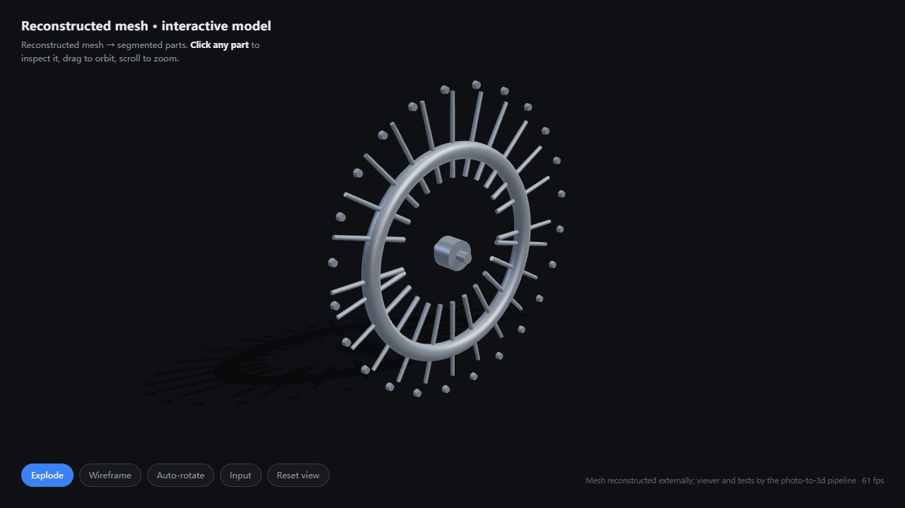

# Packed examples

Two deliverables, two different inputs, one viewer shell:

| File | Size | Input | Addressable parts |
| --- | --- | --- | --- |
| [`mdr-zx310.html`](mdr-zx310.html) | 4.0 MB | one product photograph → spec compiler (route A) | 36 component nodes / 18 meshes |
| [`spoked-wheel-mesh.html`](spoked-wheel-mesh.html) | 1.8 MB | a GLB mesh (route B) | 51 parts, 24 spokes and 24 rivets included |

Double-click either one, or drag it into any browser. No server, no CDN, no network, no sibling files —
the packer that produced them refuses to write a file that still references anything external
(`external_refs: []`). That is verified, not assumed: both were loaded over `file://` in Chrome and
reported `__IMG2THREEJS_READY__` with their part tree intact.

## What to try (both files)

| Action | What it should do |
| --- | --- |
| drag | orbit the assembly |
| scroll | zoom, clamped to the real size of the object (no falling through it) |
| click a part | only that part lights up; the readout names it, its level and its material |
| click empty space | selection clears |
| **Explode** | parts move along their own outward axis, and the camera pulls back so the assembly stays in frame |
| **Wireframe** | every mesh switches to wireframe — this is the real topology, not a decal |
| **Auto-rotate** | a slow spin; click again to stop |
| **Reference / Input** | the source photograph (route A) or the reconstruction input (route B) appears as a card |
| **Reset view** | collapse, deselect, reframe |

The button reads **Reference** on the photo build and **Input** on the mesh build, because in route B the
photo is not the thing the geometry came from.

## `mdr-zx310.html` — route A

### Provenance

Built from a single product photograph by the eight passes described in [`../SKILL.md`](../SKILL.md):
`blockout -> structural-pass -> form-refinement -> material-pass -> surface-pass -> lighting-pass ->
interaction-pass -> optimization-pass`. The workspace that holds the spec (component tree, materials,
assumptions, review history) is per-run data and is not shipped here; this file is the artifact.

What this is: a measured primitive assembly — 36 component nodes, 18 meshes, 35 textures, shaded to match
the photo. The geometry is boxes, cylinders and lathes placed by hand-written numbers in the spec; the
textures are the only part extracted from pixels. What it is not: a CAD model, and not a reconstructed
mesh. It has no dimensional accuracy, no internal structure, and cannot be used for machining,
maintenance or assembly.

Faces that the photograph does not show were inferred by symmetry. That inference is recorded in the
spec's `assumptions`, and it is the reason the rear of the headband is smooth rather than detailed.

## `spoked-wheel-mesh.html` — route B



### Provenance

Built by `assets/build/build_mesh.sh` from [`fixtures/spoked-wheel.glb`](fixtures/spoked-wheel.glb)
(179 KB) with no spec and no review passes. The viewer welded the mesh, segmented it, normalised it to unit
size and embedded it as a data URL; the six assertions then ran against the packed page. Reported stats
from the page itself:

```
meshStats: { source: "glb", partition: "angle", rawPatches: 51, parts: 51,
             triangles: 6464, normalizedExtent: 1 }
level: "mesh-part"
```

The 51 parts are the rim, hub, axle, 24 spokes and 24 rivets — every one of them was already a disjoint
island in the buffer, so the part tree came out of the file rather than being authored by hand. This is
the case the primitive route cannot reach: hand-stacking 24 spokes and 24 rivets from boxes and cylinders
is exactly where an assembly turns into loose parts, and here they are addressable without being modelled.

### What this file is not

It is **not** a neural reconstruction of a photograph. The fixture is generated geometry: a torus, three
cylinders and 48 small cylinders, exported by `assets/build/make_sample_mesh.mjs` and merged into a single
non-indexed buffer the way a CAD or DCC export arrives. Its purpose is to make the mesh route testable
without a GPU, a modelling tool or a network. Regenerate both fixtures with:

```bash
node assets/build/make_sample_mesh.mjs --modules <work>/build/node_modules --out demo/fixtures
```

[`fixtures/gear.glb`](fixtures/gear.glb) (30 KB) is the second shape: one connected extruded shell with
sharp tooth-root creases, which forces the crease splitter instead of the component splitter. It is 404
triangles and comes out as 39 parts at the default flags — that is the check that a small mesh is not
skipped just because it is smaller than `--mesh-min-segment-triangles`. Neither fixture is a scan, and
neither is a stand-in for one — the point is the part tree and the six assertions, not the surface quality.

On a real reconstruction the same page reports `partition: "spatial"` and `level: "spatial-chunk"` when
the surface has no usable creases; that label is deliberate, so nobody reads a distance-based region as a
component. See `references/traps.md` 28–30.

The product named in the route-A example is named only to identify the test subject. Nothing here is
affiliated with or endorsed by that brand.